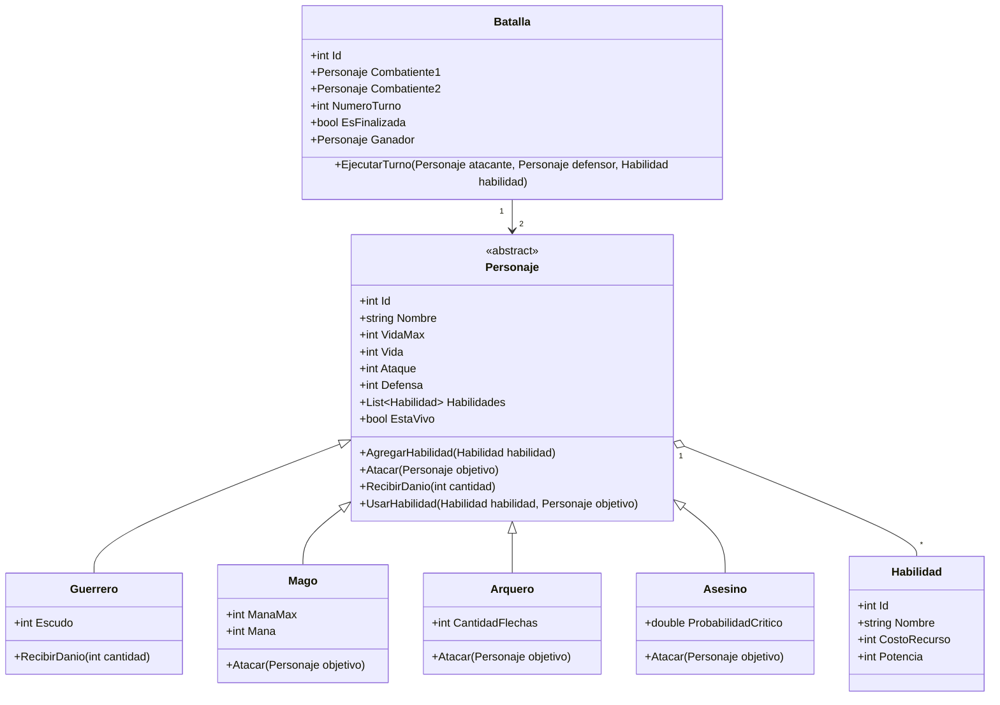
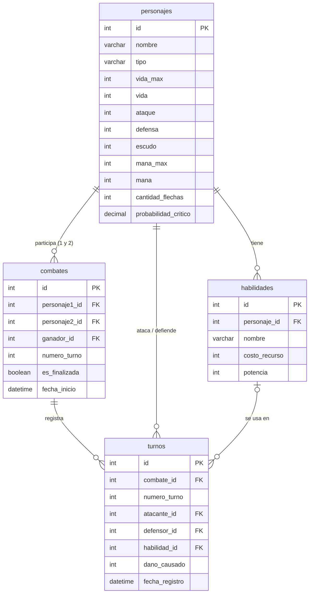

# Punto de partida

Modelo inicial de *Combate por API*, armado antes de programar. Parte de lo que ya teníamos del simulador de *Código en combate* (Software 2.3): las clases `Personaje`, `Guerrero`, `Mago`, `Arquero`, `Asesino`, `Habilidad` y `Batalla`, y la base `codigo_en_combate`. Lo que sigue son ideas y dudas, no la solución final: se contrastan en [`indagacion.md`](indagacion.md).

---

## 1. Un combate visto desde afuera

Un cliente (Swagger, Postman u otra aplicación) necesita:

1. Crear dos personajes.
2. Iniciar un combate entre ellos.
3. Ejecutar un turno.

### Recorrido propuesto

| Paso | Solicitud | Qué envía | Qué espera recibir |
| :---: | :--- | :--- | :--- |
| 1 | `POST /api/personajes` | `{ "nombre": "Thorin", "tipo": "Guerrero", "vidaMax": 120, "ataque": 18, "defensa": 8, "escudo": 20 }` | `201` con el personaje completo y su `id` |
| 1 | `POST /api/personajes` | `{ "nombre": "Merlina", "tipo": "Mago", "vidaMax": 80, "ataque": 14, "defensa": 4, "manaMax": 60 }` | `201` con el personaje completo y su `id` |
| 2 | `POST /api/combates` | `{ "personaje1Id": 1, "personaje2Id": 2 }` | `201` con el `id` del combate |
| 3 | `POST /api/combates/1/turnos` | `{ "atacanteId": 1, "defensorId": 2, "habilidadId": null }` | `201` con el turno: daño causado y vida que le queda al defensor |
| 4 | `GET /api/combates/1` | | `200` con los participantes, los turnos y el ganador si terminó |

### Qué podría salir mal

| Paso | Problema | Respuesta que imagino |
| :--- | :--- | :--- |
| Crear personaje | Nombre vacío, tipo que no existe, vida o ataque negativos | `400` |
| Iniciar combate | Un personaje contra sí mismo | `400` |
| Iniciar combate | Un ID que no existe | `404` |
| Turno | Ataca el que no le toca | `409`, porque choca con el estado del combate |
| Turno | El atacante ya fue derrotado o el combate terminó | `409` |
| Turno | El Mago no tiene maná para la habilidad | `400` |
| Turno | El combate no existe | `404` |

---

## 2. Datos comunes y comportamientos propios

| | Datos | Comportamiento |
| :--- | :--- | :--- |
| **Todos** (`Personaje`) | `Id`, `Nombre`, `VidaMax`, `Vida`, `Ataque`, `Defensa`, lista de `Habilidades` | `Atacar`, `RecibirDanio`, `EstaVivo` |
| **Guerrero** | `Escudo` | El escudo absorbe el daño antes que la vida |
| **Mago** | `ManaMax`, `Mana` | Gasta maná para hacer más daño |
| **Arquero** | `CantidadFlechas` | Gasta una flecha por ataque; sin flechas pega más débil |
| **Asesino** | `ProbabilidadCritico` | Puede pegar el doble con un crítico |

La habilidad la pienso como en 2.3: un registro `Habilidad` con `Nombre`, `CostoRecurso` y `Potencia`, asociado al personaje. El turno recibiría un `habilidadId` y calcularía el daño con la potencia.

---

## 3. Diagrama de clases inicial

Son las clases de 2.3. Lo único nuevo que propongo es `UsarHabilidad` en `Personaje`, y `Ganador` y `EjecutarTurno` en `Batalla`: en 2.3 la batalla solo guardaba los combatientes y el número de turno, y no tenía turnos alternados ni habilidades con comportamiento.

---

## 4. DER inicial

Son las tablas de `codigo_en_combate` con los nombres que pide la consigna: `Batallas` pasa a ser `combates` y `HistorialBatallas` pasa a ser `turnos`. Las columnas quedan como en 2.3, así que la vida y el maná actuales siguen en `personajes`.

---

## 5. Qué conservar después de cada turno

- En `turnos`: número, atacante, defensor, habilidad usada (si hubo) y daño causado.
- En `personajes`: la vida, el maná, el escudo y las flechas que le quedan a cada uno.
- En `combates`: el número de turno siguiente, si terminó y quién ganó.

---

## 6. Hipótesis

1. **Estado en el personaje**: la vida y el recurso actuales se guardan en `personajes`, como en 2.3.
2. **Habilidades como datos**: cada habilidad es una fila con costo y potencia, y el turno la elige con `habilidadId`.
3. **Defensor explícito**: el cliente indica atacante y defensor en cada turno.
4. **Estadísticas desde el cliente**: el `POST` de personajes recibe vida, ataque, defensa y el recurso propio del tipo.
5. **Entidad como respuesta**: la API devuelve el objeto `Personaje` tal cual, serializado a JSON.
6. **Creación por tipo**: un `switch (tipo)` decide qué subclase instanciar.
7. **Una sola conexión**: alcanza con un usuario con todos los permisos sobre la base, como `desarrollador` en 2.3.
8. **Códigos de error**: atacar fuera de turno es un conflicto con el estado, así que corresponde `409`.
9. **Ejecutar un turno devuelve `201`**: porque crea un registro nuevo en `turnos`.
10. **Deshacer un turno**: se puede recalcular el daño y devolvérselo al defensor.
11. **Turno en un stored procedure**: el turno se guarda como en 2.3 con `sp_ProcesarAccionCombate`, que inserta el historial y actualiza la vida del defensor en `personajes`.
12. **Backup**: con `mysqldump` de la base alcanza para restaurar todo, usuarios incluidos.

---

## 7. Dudas

**Rutas y solicitudes**
- En `/api/combates/{id}/turnos`, ¿alcanza con el `id` de la ruta o hay que repetirlo en el cuerpo del turno?
- ¿Cómo indica el cliente si ataca o usa la habilidad? ¿Con un `habilidadId`, con un texto o con dos rutas distintas?
- ¿Hace falta mandar el defensor si en el combate siempre hay solo dos participantes?

**Respuestas**
- ¿Qué diferencia hay entre `200` y `201`? ¿Cuándo corresponde cada uno?
- ¿Qué devuelve un `DELETE`: el objeto borrado o nada?
- ¿Conviene devolver el objeto del dominio o crear clases solo para la respuesta?
- ¿Cómo se ven estas rutas y sus respuestas en Swagger?

**Base de datos y permisos**
- Si un personaje pelea en dos combates a la vez, ¿dónde se guarda su vida en cada uno?
- ¿Qué permisos necesita una conexión que solo consulta? ¿Cómo hace la API para usar una conexión u otra?
- ¿Dónde se guardan las contraseñas de conexión para no subirlas a GitHub?
- ¿El backup incluye los usuarios? ¿Qué hay que ejecutar después de restaurarlo?
